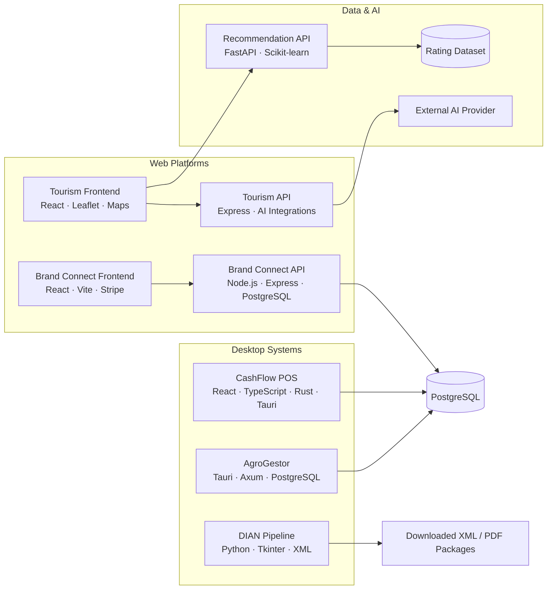
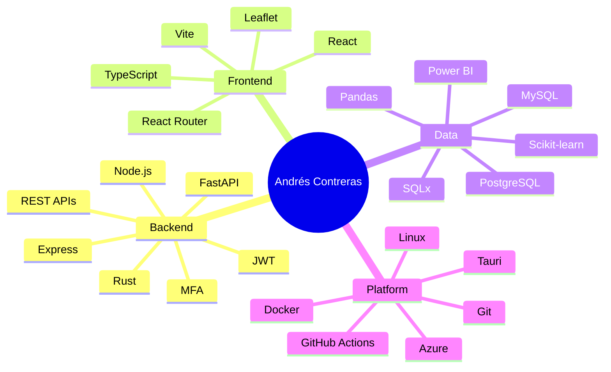

  

  <h3>Systems Engineering Student · Full-Stack & Desktop Developer</h3>

  <b>Bogotá, Colombia</b> · Building useful software across desktop, web, data, and AI systems

  
  
  
  

---

## Engineering Profile

I build complete, maintainable software products rather than isolated exercises:

- desktop applications and local business workflows
- REST APIs and PostgreSQL-backed web systems
- React and TypeScript interfaces
- Python automation and data-processing pipelines
- AI-assisted features with controlled provider integrations
- Dockerized services and Azure/GitHub Actions deployments

I am currently a **ninth-semester Systems Engineering student** at Universidad Piloto de Colombia and seek a full-time enterprise internship in **full-stack or backend development**.

## Portfolio Architecture

---

## Featured Projects

### [CashFlow POS](https://github.com/AndresContreras1034/CashFlow-POS)

Windows desktop POS and business-management system with inventory, Kardex, sales, customers, debts, suppliers, cash sessions, reports, backups, printing, auditing, and offline license validation.

**Stack:** React 19 · TypeScript · Vite · Tauri 2 · Rust · SQLx · PostgreSQL

**Engineering evidence**

- 32 versioned database migrations in the repository
- Tauri commands separated into handlers, services, repositories, models, and DTOs
- Typed PostgreSQL access and startup migrations
- Inventory import safety backup and restore workflows
- 231 frontend Vitest tests across 22 test files
- Windows-specific printing and encrypted backup support

---

### [Brand Connect](https://brandconnect.social)

Full-stack marketplace for brands and content creators.

| Repository | Purpose |
|---|---|
| [Frontend](https://github.com/AndresContreras1034/Frontend-brandconnect) | React/Vite interface, authentication, marketplace, chat, profiles, and payment states |
| [Backend](https://github.com/AndresContreras1034/backend-brandconnect) | Node.js/Express API, JWT, TOTP MFA, PostgreSQL, Stripe, Swagger, Docker, and Azure deployment |

**Stack:** React · Vite · Node.js · Express · PostgreSQL · Stripe · Docker · Azure

**Engineering evidence**

- JWT and TOTP MFA authentication flows
- Stripe checkout, subscription, and webhook routes
- Swagger API documentation
- Role and authentication middleware
- Separate frontend/backend repositories
- Azure Static Web Apps and Azure App Service workflows

> Status: integration and test coverage are still being strengthened. Public environments depend on external provider configuration.

---

### [Tourism AI](https://frontend-tourism-ai.vercel.app)

Tourism planning application with recommendations, interactive maps, weather, itinerary assistance, and a separate machine-learning API.

| Repository | Purpose |
|---|---|
| [Frontend](https://github.com/AndresContreras1034/frontend-tourismAI) | React/Vite interface, Leaflet map, Expo dashboard, weather and AI interactions |
| [Backend](https://github.com/AndresContreras1034/backend-tourismAI) | Express beta/full APIs, FastAPI recommendation service, Open-Meteo, OpenStreetMap, and provider integrations |

**Stack:** React · Vite · Leaflet · Node.js · Express · FastAPI · Pandas · Scikit-learn

**Engineering evidence**

- Random Forest recommendation service trained from a local tourism rating dataset
- FastAPI catalog and recommendation endpoints
- 2 recommendation engine tests passing
- Public beta health endpoint verified
- Open-Meteo, Nominatim, and Overpass integrations
- Production frontend deployed on Vercel
- [Interface screenshot](https://github.com/AndresContreras1034/frontend-tourismAI/blob/main/docs/tourism-ai-expo.png)

---

### [DIAN Document Pipeline](https://github.com/AndresContreras1034/DIAN-Data-Pipeline-System)

Desktop automation tool for processing electronic DIAN documents in a repeatable workflow.

**Stack:** Python · Tkinter · Requests · XML · REST APIs · CSV

**Engineering evidence**

- Browser-session cookie authentication
- Paginated document retrieval
- ZIP integrity validation and safe extraction
- XML parsing and VAT categorization
- Desktop progress and live-log interface
- Sensitive cookies, logs, caches, and downloaded packages excluded from Git

---

## Technical Stack

## Experience

- **Asociación Huella de Carbono** — Full-Stack Developer, Remote
  Contributing to architectural decisions and developing features across frontend and backend.
- **IoT/ITS Research Group** — Developer, IEEE Student Branch, Universidad Piloto de Colombia
  Collaborating on applied research projects in the Internet of Things and Intelligent Transportation Systems.

## Education & Learning

- Systems Engineering — Universidad Piloto de Colombia, ninth semester
- CS50x and CS50R — Harvard University
- CS50 SQL and CS50 Python — in progress
- Data Analytics Explorer Bootcamp — MinTIC
- GCI Global Data Science — Matsuo-Iwasawa Lab, University of Tokyo

## Current Objectives

- Deepen automated testing and CI/CD across portfolio projects
- Strengthen database migration and deployment reproducibility
- Complete and document AgroGestor
- Reach C1 English proficiency
- Obtain a full-time internship in full-stack or backend development

### Contact

[LinkedIn](https://www.linkedin.com/in/andr%C3%A9s-contreras-67720a31a/) · [Email](mailto:Andresfcmdev@outlook.es) · [Phone](tel:+573016110168)

